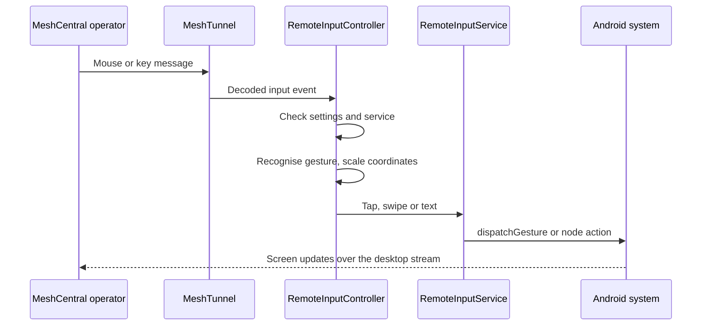

# Remote Input on Android

This document describes how a MeshCentral operator can control an Android
device, and the consent and platform limits that apply.

## Summary

Remote input is **off by default** and needs two separate approvals from the
device user before an operator can do anything:

1. **Remote Input** has to be switched on in the agent's settings screen.
2. **MeshCentral Remote Input** has to be enabled in Android's accessibility
   settings, which only the device user can do.

With either one off, input messages from the server are decoded and discarded,
and the remote session stays view only. Turning the accessibility service off in
Android settings ends remote control immediately, with no agent restart.

Android does not let an ordinary application inject input events, so control is
implemented with the public
[accessibility gesture API](https://developer.android.com/reference/android/accessibilityservice/AccessibilityService#dispatchGesture(android.accessibilityservice.GestureDescription,%20android.accessibilityservice.AccessibilityService.GestureResultCallback,%20android.os.Handler)).
That API needs Android 7.0 (API 24), so remote input is unavailable on Android
6.0 even when both switches are on.

## Components

- `RemoteInputProtocol.kt` decodes the binary input messages and recognises
  gestures. It has no Android dependencies and is covered by unit tests.
- `RemoteInputService.kt` is the accessibility service that performs gestures,
  navigation actions and text entry.
- `RemoteInputController.kt` connects the two, applies the consent checks, and
  scales coordinates back to device pixels.
- `MeshTunnel.kt` passes usage-2 binary input commands to the controller.

## Session Flow



## Input Mapping

The operator works with a mouse and keyboard, and the device has a touch screen
and no pointer, so input is translated rather than replayed:

| Operator action | Device result |
| --- | --- |
| Click | Tap at that point |
| Press and hold in place (500 ms or longer) | Long press |
| Press, move, release | Swipe over the same path and duration |
| Mouse wheel | Vertical swipe under the pointer |
| Right click | Back |
| Middle click | Home |
| Typed character | Appended to the focused text field |
| Backspace or Delete | Removes the last character of the focused field |
| Enter | Editor action of the focused field, such as search or send |
| Escape | Back |
| Home or Meta | Home |
| Page Up, Page Down | Swipe up or down the middle of the display |

Coordinates arrive in the coordinate space of the image the agent sent, so they
are scaled back up by `1024 / scalingLevel` and clamped to the display before a
gesture is dispatched.

Text entry works through the focused node rather than a key stream: the agent
reads the focused text field, appends the typed character and writes the field
back. A field has to have input focus, and fields that refuse
`ACTION_SET_TEXT`, such as some password and custom editors, cannot be typed
into. The console reports "No text field has focus on the device" rather than
failing silently.

## Console Commands

Remote input can also be driven from the MeshCentral console, which is useful
for a single action without opening a desktop session:

```
input                               Report whether remote input is available
tap 540 1200                        Tap a point, in device pixels
swipe 540 1600 540 600 300          Swipe between two points over 300 ms
type "hello"                        Type into the focused text field
back, home, recents, notifications  System navigation
lock                                Lock the screen, Android 9 or later
```

Console coordinates are device pixels and are not scaled.

## Limitations

- Input lock is accepted and ignored. Android cannot block input on the
  physical device, so the device user can always interact at the same time.
- Gestures are dispatched one at a time. A new gesture replaces one still in
  flight, so very fast operator input can drop intermediate movements.
- The accessibility service cannot act on system windows that opt out, such as
  parts of the Android settings UI and other accessibility overlays.
- Secure surfaces that MediaProjection cannot capture are equally out of reach
  for input, because the operator cannot see them.
- `lock` needs Android 9 (API 28) or later.

## Privacy

The accessibility service declares `canRetrieveWindowContent` because text entry
has to read the focused field in order to append to it. The agent does not
inspect, store or report screen content, and `onAccessibilityEvent` does no
work. Every remote input action is logged to the MeshCentral server through the
usual console event path.
